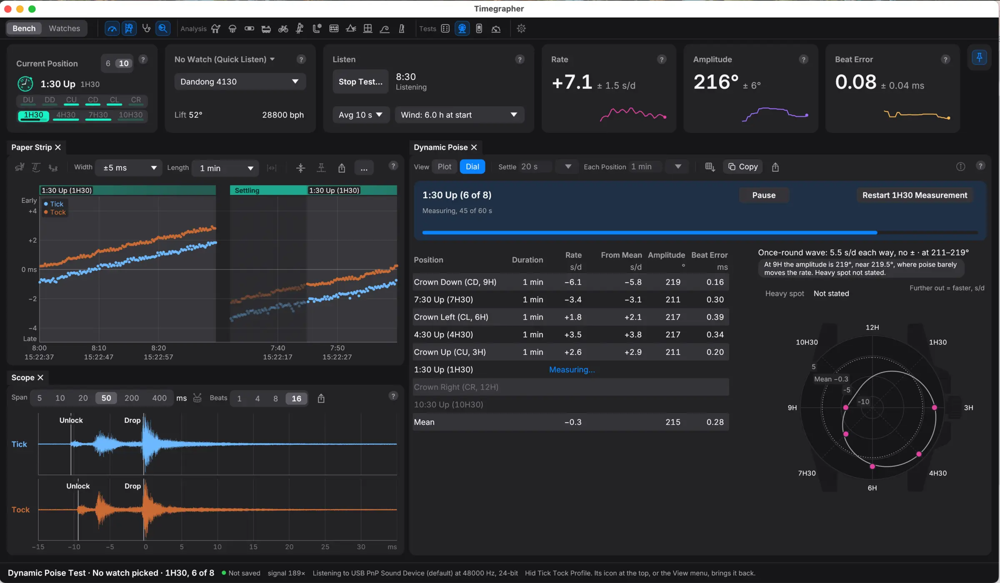
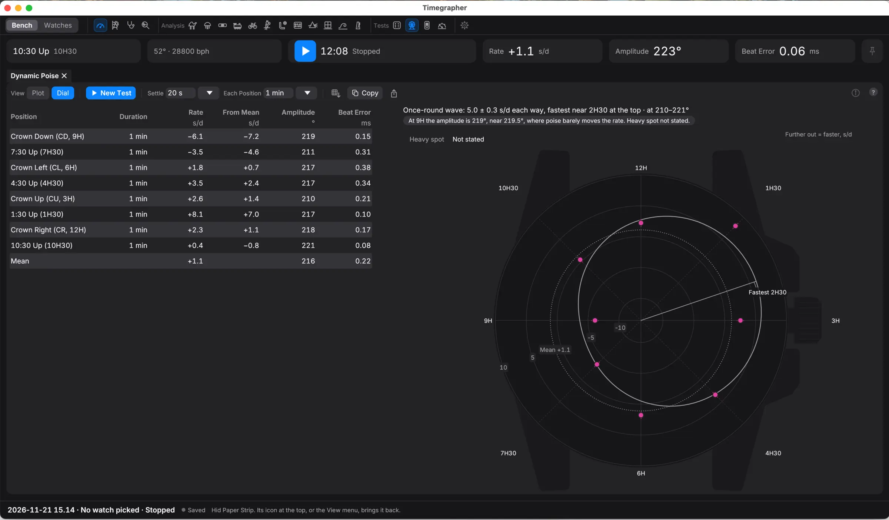
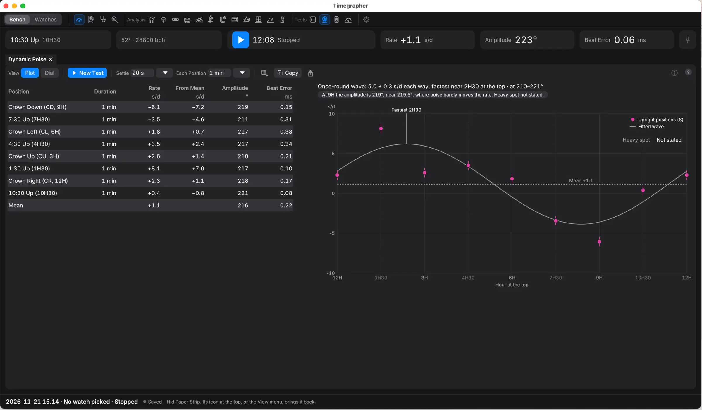
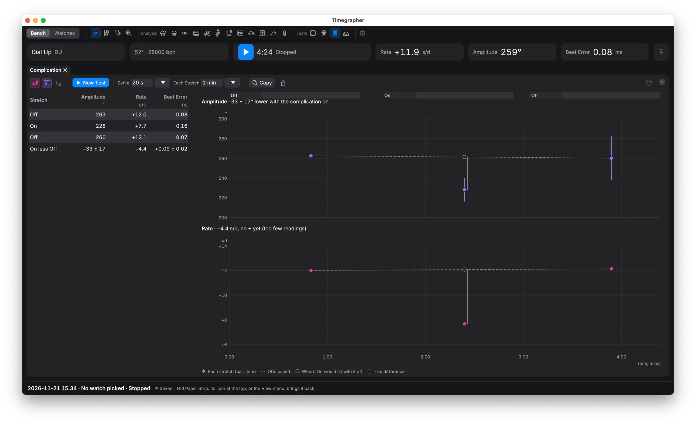
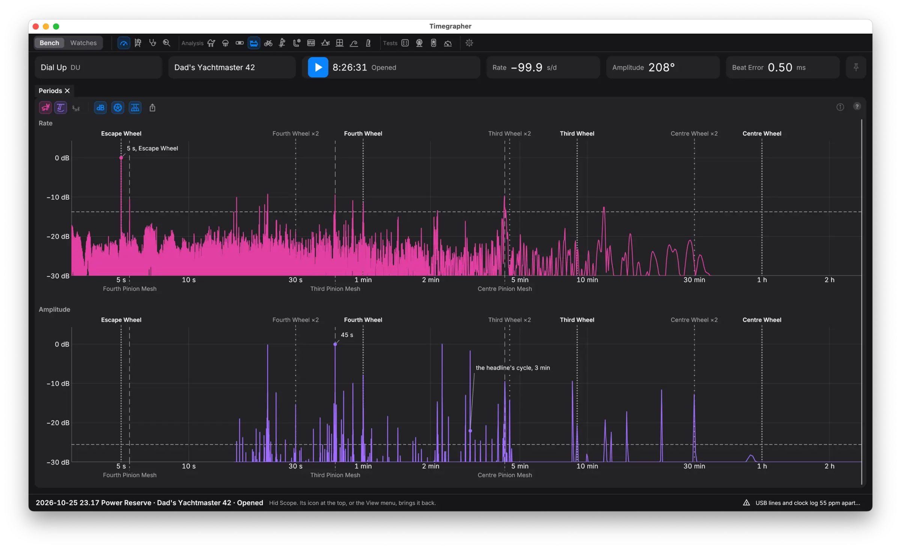
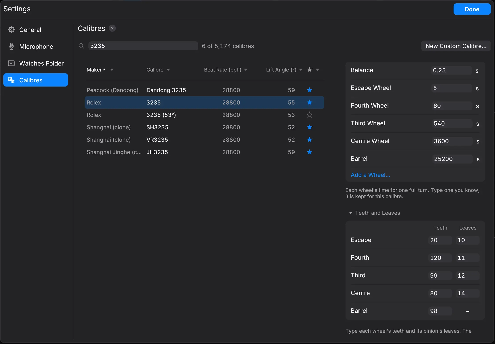
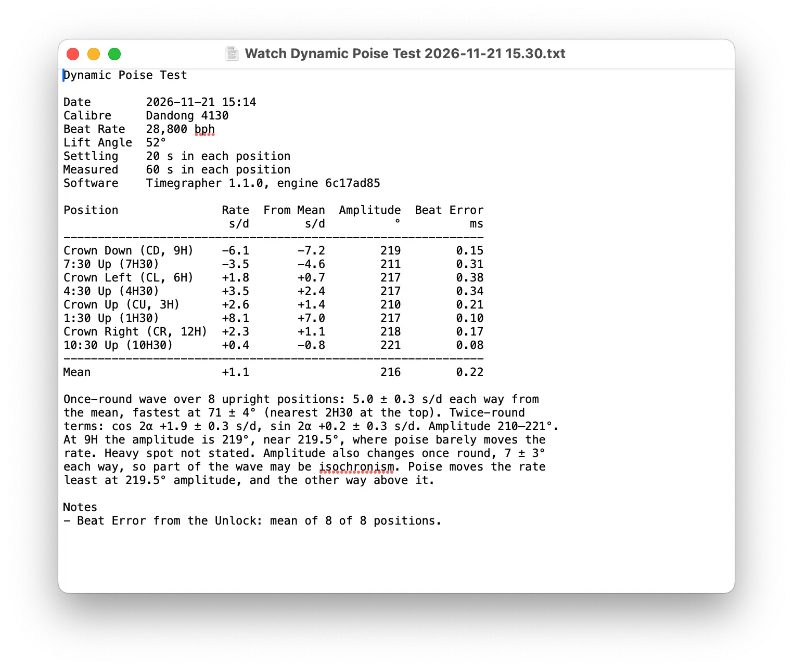

*Peter wrote this for [r/watchrepair](https://www.reddit.com/r/watchrepair/comments/1y2aktk/update_v11_of_timegrapher_free_open_source_for/) on 21 November 2026 with a brutal head cold, under the influence of NyQuil. It is lightly edited for this site; at his request the typos stay in. (Wesley, who looks after this site)*

Eleven days ago I made a [post](https://www.reddit.com/r/watchrepair/comments/1xsyh83/new_release_free_timegrapher_software_for/) here about the initial release of v1.0 of a new free and open source Timegrapher app for MacOS, Windows, and Linux. I'm now ready to release version 1.1 of Timegrapher.

Timegrapher v1.1 can be downloaded [here](/download/).

For those who didn't see my initial release here's a quick summary ([details in the initial announcement post](https://www.reddit.com/r/watchrepair/comments/1xsyh83/new_release_free_timegrapher_software_for/)): Timegrapher is a project I'm building for myself (I'm a retired engineer and hobby watchmaker) to open up access to the advanced analytics tools that you'd previously need to spend thousands of dollars to get by buying something like a Witschi Chronoscope. The app works with any USB contact microphone. It will also work nicely with the [u/TimeTellsTime](https://www.reddit.com/user/TimeTellsTime/) [GX16 to USB adapter](https://benchtimer.timtellstime.com/#adapter) (Thank you Tim for testing this and confirming). Timegrapher gives you things like:

- Per beat analysis in the profile and scope
- Isochornism plot including an isochronorism walk plot showing how isochronorism changes during a run down test
- Periodic cycle analysis to look for out of round train wheels
- A calibre database with over 5000 movements. This is editable and your contributions can be shared with the community (Thank to your Leon for the first [community contribution](https://github.com/peterhudson/timegrapher/issues/1611) of the PUW 360 calibre data)
- Position testing and Power reserve testing
- Fourier Transform (FFT), Short Time Fourier Transform (STFT), and Wavelet analysis
- Watch manager to store and save all your analysis

So, what's new in version 1.1? Here are the headline new features (full release notes are on the [What's new](/whats-new/) page).

## Dynamic Poise Testing

This is the big new feature. Thank you to [u/Lost_Pinion](https://www.reddit.com/user/Lost_Pinion/) for the suggestion. The idea of this test is that you can measure the rate at 45 degree increments in the vertical position and if the amplitude is far enough away (above or below) 220, you can calculate the heavy spot on the balance wheel from the difference in rate across the vertical positions.

There are two more community suggestions / contributions visible in the screenshot above: [u/RyFly05](https://www.reddit.com/user/RyFly05/) wanted to be able to display wall clock time along the bottom of the paper strip. He made a pull request on GitHub and after some back and forth from the code review bots, his changes were [merged](https://github.com/peterhudson/timegrapher/pull/2170). Also, thank you to [u/xZero_Coolx](https://www.reddit.com/user/xZero_Coolx/) for the request for the fixed length over writing paper strip chart.

For the dynamic poise test I like the radar style watch dial plots of these results, but I also included the standard unwrapped version of the plot:

## Complication Test

This is a useful test if you work on chronographs. It's not that complicated: it'll record the watch with the complication off, then when it's on, and again when it's off. The results are presented in a nice little chart and table.

## Tooth and Leaf Calculator

This is an addition to the calibre database. One of the coolest features (I think) of Timegrapher is the periodic cycle analysis which can fund cycles in rate, amplitude, and beat error in longer takes (see below).

However, these period analysis plots become much richer when you can overlay the periods of the train wheels and also the periods of the pinon meshes. But that requires knowing the rotation periods of each of the train wheels for the calibre you're working on; and for mesh periods it requires tooth counts. Since tooth counts can be used to back calculate the rotation periods of the train wheels, I added a calculator directly into the calibre manager:

I also added simple text exports for the test results (I should have mentioned this earlier). I'm working on a more robust and customizable PDF reporting feature set for v1.3, so for now these are just there to hold the fort. That said, there is a full CLI and MCP interface to the software so you can just point your AI agent at the app and it should be able to extract any data and analysis that you see in the app itself and put it into any fancy format you want.

Oh and one more thing that pops to mind. After the initial release announcement [u/GhostUnitVII](https://www.reddit.com/user/GhostUnitVII/) wanted to run it on an ARM powered linux device. I hadn't thought about ARM devices, so my Linux builds were only for x86. That's now fixed and the release supports Mac (both Apple and Intel), Windows, and Linux (x86 and ARM).

I also registered a domain name, opentimegrapher.org, where I'm starting to build out this website that can serve as a slightly more user friendly place to find info about the project. GitHub is great, but I know it's not everybody's cup of team. One of the first things on the new site is the Team page where you can find out a little more about the [team behind the project](/team/). What comes after 1.1 is on the [roadmap](https://github.com/peterhudson/timegrapher/blob/main/ROADMAP.md).
