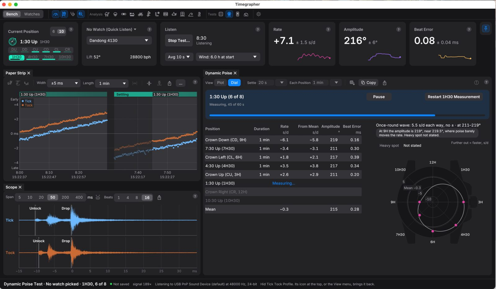
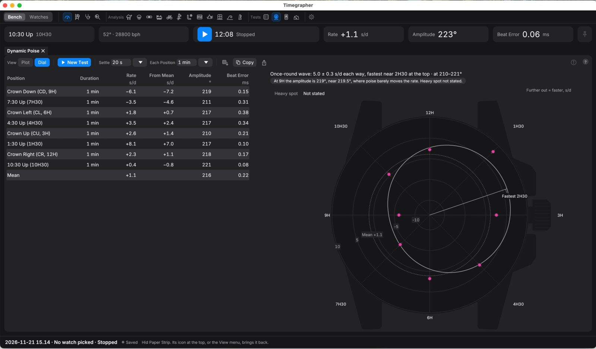
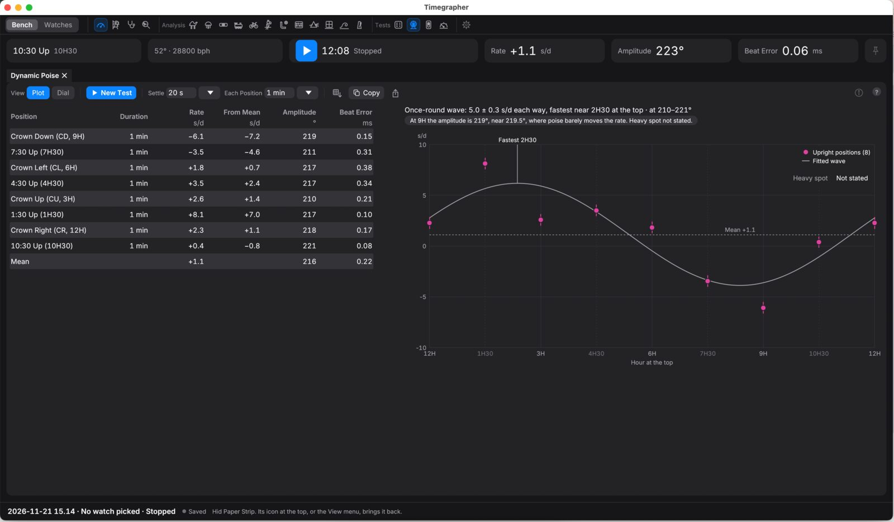
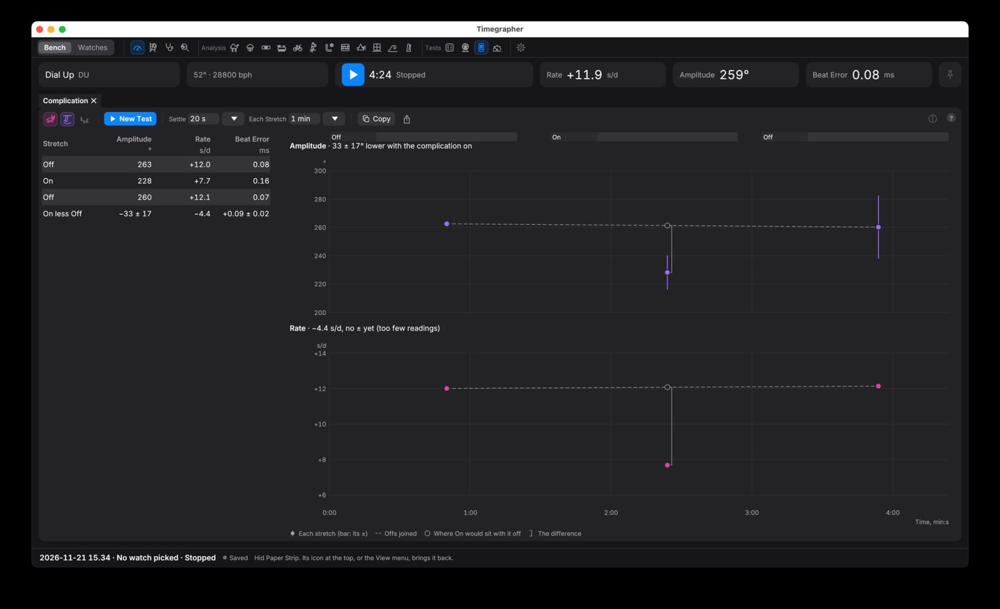
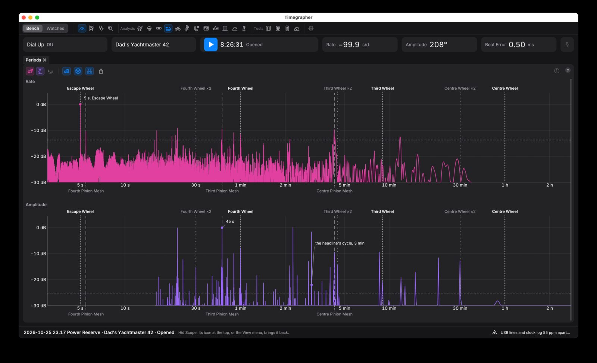
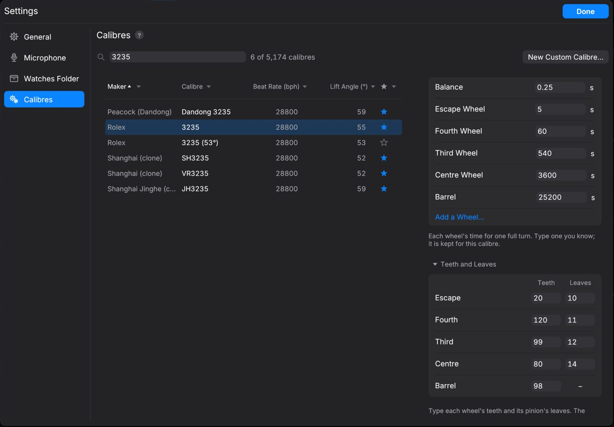
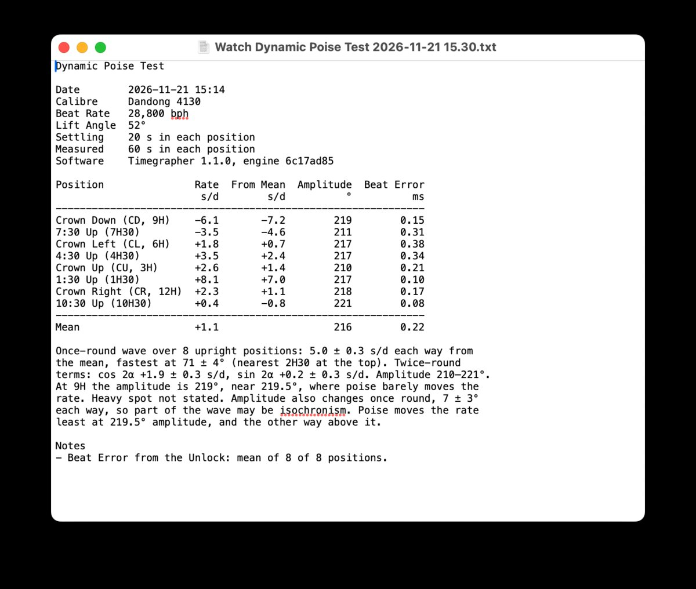

Eleven days after [version 1.0](https://www.reddit.com/r/watchrepair/comments/1xsyh83/new_release_free_timegrapher_software_for/), version 1.1 is out. [Download it here](/download/); the full list of changes is on [What's new](/whats-new/).

If you're new here: this is a project I'm building for myself. I'm a retired engineer and hobby watchmaker, and I wanted the kind of analysis you'd otherwise spend thousands of dollars on, in something like a Witschi Chronoscope. It works with any USB contact microphone, and with Tim's [GX16 to USB adapter](https://benchtimer.timtellstime.com/#adapter) (thank you, Tim, for testing it). It gives you:

- per-beat analysis in the Tick Tock profile and the Scope;
- an isochronism plot, including an isochronism walk that shows how it changes during a run-down test;
- periodic cycle analysis, to look for out-of-round train wheels;
- a calibre database with over 5,000 movements, which you can edit and share (thanks to Leon for the [first community contribution](https://github.com/peterhudson/timegrapher/issues/1611), the PUW 360);
- Positions and Power Reserve tests;
- Fourier (FFT), short-time Fourier (STFT) and wavelet analysis;
- a watch manager that keeps every take and its analysis.

## Dynamic Poise Test

This is the big one. Thank you to u/Lost_Pinion on Reddit for the suggestion. You measure the rate at 45° steps with the watch upright. If the amplitude is far enough above or below about 220°, the difference in rate round the circle tells you where the heavy spot on the balance is.

Two more community ideas are in that picture. Ryfly wanted wall-clock time along the bottom of the Paper Strip. He made a pull request, and after some back and forth with the code review agents it was [merged](https://github.com/peterhudson/timegrapher/pull/2170). And thanks to u/xZero_Coolx on Reddit for asking for a fixed-length paper strip that the pen writes over: that's **Still Paper**.

I like the dial view of the results, a radar plot laid on a watch case, but the usual unwrapped plot is there too:

## Complication Test

Useful if you work on chronographs. It isn't complicated: it times the watch with the complication off, then on, then off again, and shows what changed in a small chart and table.

## Tooth and leaf calculator

This one is part of the calibre database. One of the features I like best is the periodic cycle analysis, which finds cycles in rate, amplitude and beat error over longer takes:

Those plots get much richer when you can mark the period of each train wheel, and of each pinion mesh. That needs each wheel's rotation period for your calibre, and the tooth counts for the meshes. Tooth counts also give you the wheel periods, so I put a calculator straight into the calibre manager:

## Text reports

The Positions and Dynamic Poise tests can now save a plain text report. A fuller PDF report you can customise is the headline for a later release, so these hold the fort until then. There is also a full command line and MCP interface, so you can point your AI agent at the app and have it pull out any figure you see on screen and put it in whatever format you like.

## ARM Linux

After the 1.0 announcement u/GhostUnitVII on Reddit wanted to run it on an ARM Linux board. I hadn't thought of ARM, so the Linux builds were x86 only. That's fixed: 1.1 runs on Mac (Apple silicon and Intel), Windows, and Linux on x86 and ARM.

## This site

GitHub is great, but it isn't everybody's cup of tea, so this site is meant to be a friendlier place to find out about the project. Start with [the team behind it](/team/), and the [roadmap](https://github.com/peterhudson/timegrapher/blob/main/ROADMAP.md) for what comes next.

*Adapted from my post on r/watchrepair, 21 November 2026.*
