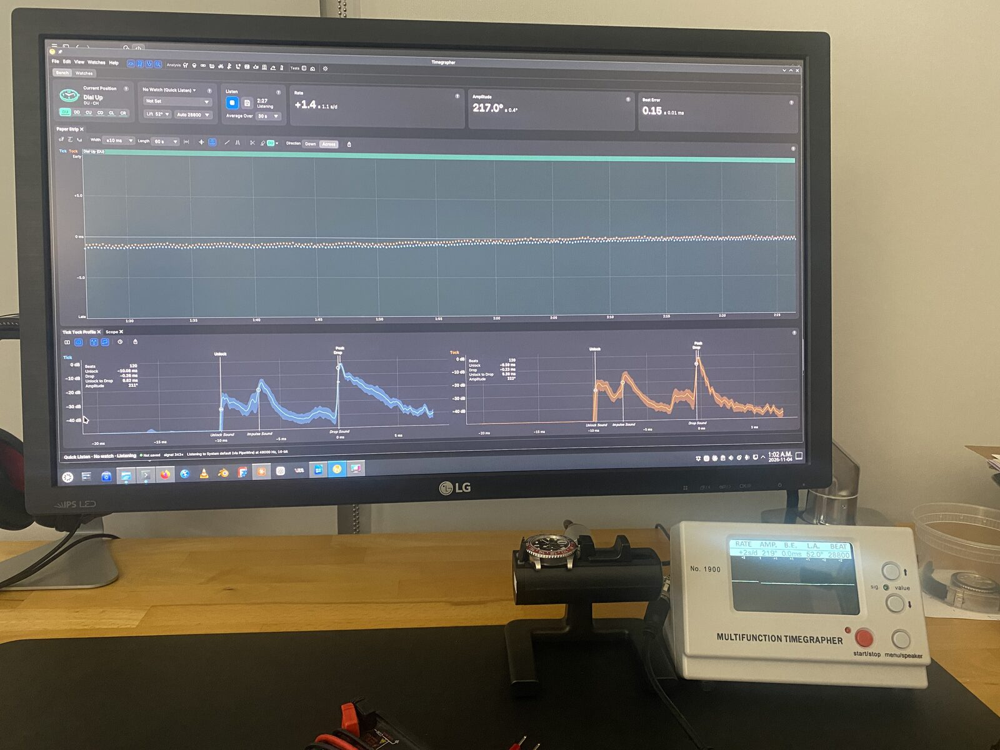
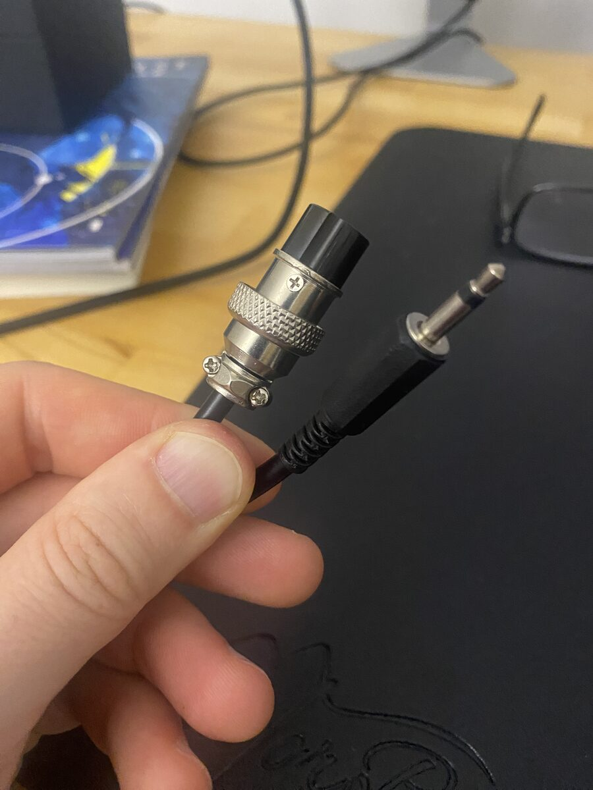
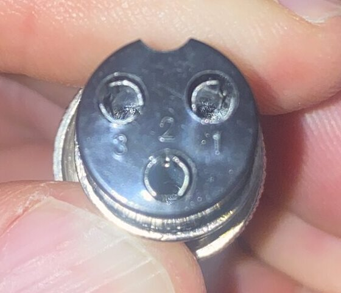
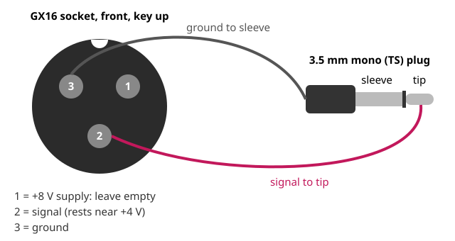

Most bench timegraphers sold today, from the inexpensive "No. 1900" boxes up, use a stand with a contact microphone on a three-pin GX16 plug. Peter already had one on his bench. He wanted Open Timegrapher to hear the same stand, at the same time, so he could check one against the other.

It took one evening, a Y-splitter, an adapter, a soldering iron and a multimeter. It works: the app and the box now agree. It also went wrong twice before it went right, and both mistakes are worth knowing about if you try this yourself.



## The setup

- **The bench box** is a Chinese "No. 1900 Multifunction Timegrapher". These are sold under several names; Peter's has no maker's name on it. It powers the stand's microphone over the GX16 cable.
- **A GX16 Y-splitter** sits between the stand and the box. One leg goes to the box, as before.
- **A GX16-to-3.5 mm adapter** on the other leg. Its plug is a **mono (TS) plug**: two contacts, tip and sleeve, not three.
- **The computer** is Peter's Kubuntu workstation. The plug goes into the blue **Line In** jack.

Because the box still powers the microphone, the computer only has to listen. Nothing needs a battery.

## What went wrong first

The adapter came wired for some other purpose. With the box switched on, Peter measured **8 V DC between the plug's tip and its sleeve**. The tip was carrying the microphone's power supply, not its sound.

A ten-second recording showed what that meant. The tip channel had no ticks at all. The other channel, whose contact was resting on the plug's sleeve, carried a buzz locked to the 60 Hz mains, in bursts every 8.3 ms. There was no beat anywhere in it.

The first agent on the job lost time and Peter's trust by giving Peter steps built on what such a plug usually looks like rather than on what his plug was. He asked for a reading on the plug's "ring", but a mono plug has no ring. Peter was standing at the bench with a meter and a live box, and he stopped the session. The lesson went into our rules that night: **never give a hands-on step built on an unchecked guess about someone's hardware**. Ask for a photo first, and never state a pinout without a source.

## Finding the pins

Ian started again from photos. The aux end of the adapter is moulded shut. The GX16 end has a clamp with two screws and a small screw in the body, so that's the end that can be rewired.



The adapter's socket has three holes, and the numbers are moulded into the insert. Seen from the front with the key at the top, they read 3, 2, 1 from left to right, with hole 2 at the bottom.



Then two checks with the meter:

1. **Continuity, with everything unplugged.** The plug's tip went to hole 1, its sleeve to hole 3. Hole 2 went nowhere.
2. **Voltage, on the box's side of the splitter, box on.** Measured from pin 3: pin 1 read **+8 V**; pin 2 read about **+4 V**, and wobbled.

About half the supply, and moving: that is what the output of a microphone amplifier running from a single supply usually looks like. Two public sources agree. An [EEVblog teardown of the Weishi No. 1900](https://www.eevblog.com/forum/reviews/weishi-no-1900-multifunction-timegrapher-teardown/) says of the microphone's wires: "black is +8V" and "Yellow is signal." A [guide to connecting a Weishi timegrapher microphone to a PC](https://kukkunaws.blogspot.com/2025/06/connecting-weishi-timegrapher.html) wires a battery's negative to pin 3, its positive to pin 1 through a resistor, and takes the sound from "the number 2 pin" through a 1 µF capacitor.

So the fix was to move the tip's wire from hole 1 to hole 2, leave hole 1 empty, and leave hole 3 on the sleeve. The wires were soldered. Peter desoldered and resoldered the one wire, and checked it with the meter: tip to hole 2, connected; tip to hole 1, not; sleeve to hole 3, connected.



## The second thing that went wrong

The next two recordings were silent apart from faint hiss. Even a fingernail tapped on the stand didn't show up. It looked as though pin 2 wasn't the sound after all.

It was. When Peter unplugged the lead to rewire it and plugged it back in, Kubuntu had quietly switched the sound card's input from **Line In** to **Rear Microphone**, an empty pink jack. The recordings were of nothing. One command put it back:

```
pactl set-source-port alsa_input.pci-0000_00_1f.3.analog-stereo analog-input-linein
```

The source name on your computer will differ: `pactl list sources` lists yours, with its active port. The next recording had the watch in it, a beat every 125.0 ms, 28,800 beats per hour.

## Getting the level right

With Line In at 100% the ticks were far too loud: about one sample in five was clipped. Clipping flattens the top of each tick, and the beat error and amplitude are read from the tick's shape. At 25% the peak of every tick still touched full scale. At **15%** nothing clipped, tick peaks ran from 38% to 64% of full scale, and each tick stood about 90 times above the noise between beats. The second channel was silent, as it should be with a mono plug.

Your sound card and your stand will need a different setting. Start low and raise it until the ticks are clear without touching the top. The app's status bar says when the input is clipping.

## The result

Peter opened Open Timegrapher, chose **System default (via PipeWire)** as the microphone, and pressed Listen. With the same watch on the same stand:

| | Rate | Amplitude | Beat error |
|---|---|---|---|
| Open Timegrapher | +1.4 ± 1.1 s/d | 217° | 0.15 ms |
| The bench box | +2 s/d | 219° | 0.0 ms |

Peter's verdict, at 1 am: "Timegrapher and my benchtop unit agree (within digit flicker anyway)."

The box shows whole seconds per day and whole degrees. The two readings come from one stand at one time, so they are a check that the software and the box hear the same watch, not a calibration of either.

## If you try this

- **Measure your own connector before you solder.** GX16 is only a connector; the pinout belongs to whoever made the stand. Ours matched both sources above, but your stand may not. Pin numbers are moulded on the insert, and they read mirrored from the back, so check from the side you're looking at.
- **Leave the supply pin empty.** It carries the stand's +8 V. Peter's sound card took no harm while it was on the tip, but it isn't sound and it doesn't belong on an audio input.
- **Consider the capacitor.** The guide above puts a 1 µF capacitor in series with pin 2, which keeps the +4 V resting level off the sound card. We didn't, and Peter's Line In blocked it on its own. A capacitor costs pennies and doesn't depend on that.
- **Check the input port after every replug**, on Linux at least.
- **Don't want to solder?** Tim sells a [GX16 to USB adapter](https://benchtimer.timtellstime.com/#adapter) that Open Timegrapher works with.
